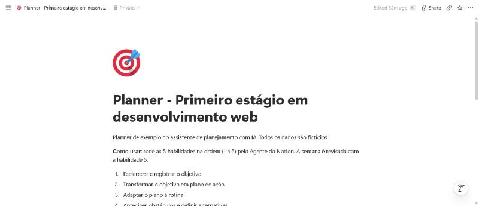
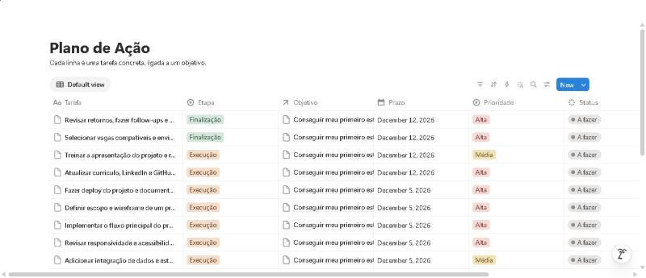
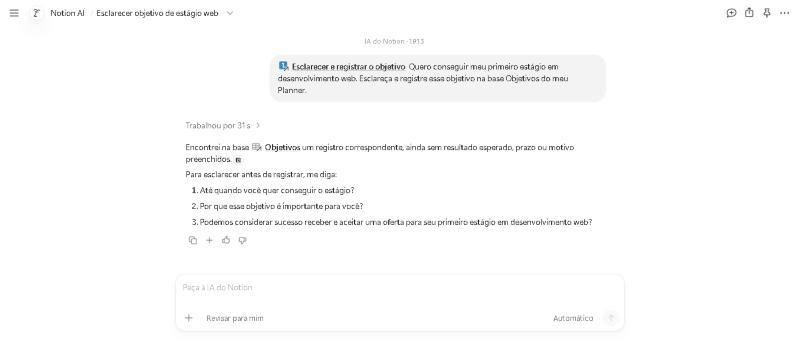
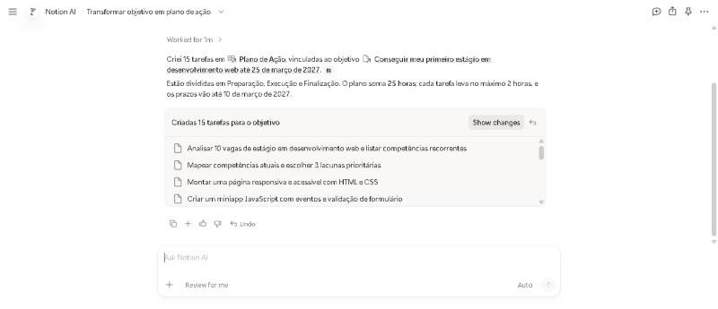
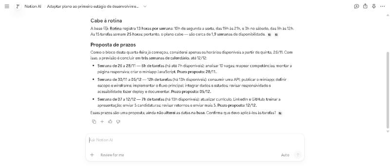
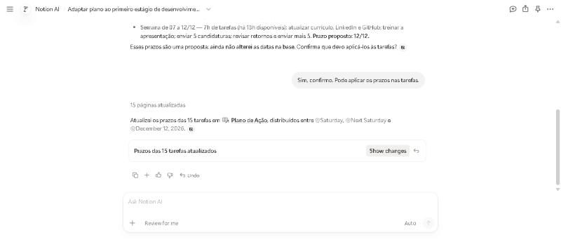
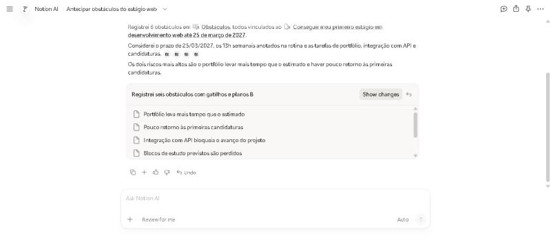
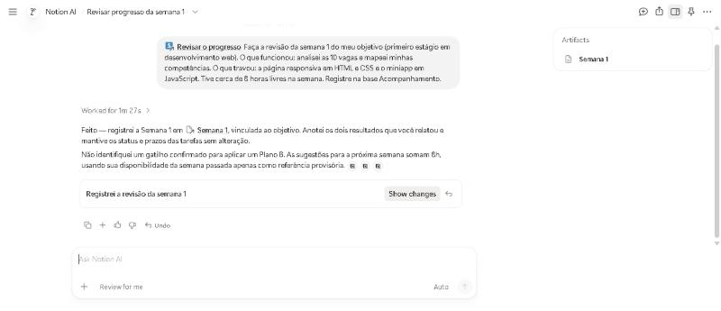

# Assistente de Planejamento com IA: Planner no Notion + Habilidades

Um Planner no Notion e cinco habilidades (skills) que ensinam a IA a tirar **qualquer objetivo** do papel e manter o plano andando. Como estudo de caso, usei um objetivo de carreira: **conseguir o primeiro estágio em desenvolvimento web**.

> Todos os dados deste documento são fictícios. Nenhum print traz informação pessoal ou confidencial.

---

## 1. O problema e o diferencial

Todo mundo que já teve um objetivo grande conhece o roteiro: empolga, anota umas coisas, e duas semanas depois o plano virou um arquivo esquecido. Quando tento usar IA pra isso, caio em outro problema: cada conversa nova começa do zero e eu preciso explicar o método de novo.

O assistente resolve as duas coisas:

- **O Planner guarda o plano num lugar só** (objetivo, tarefas, rotina, obstáculos e acompanhamento), tudo ligado por relações.
- **As habilidades guardam o método.** Eu escrevo as instruções uma vez e a IA passa a seguir o mesmo passo a passo sempre, sem eu repetir prompt.

**O diferencial:** as habilidades não são feitas pro meu objetivo. Elas perguntam, planejam e revisam qualquer meta (estudo, carreira, negócio). Trocou o objetivo, o método continua valendo.

---

## 2. Recursos usados e por que escolhi cada um

| Recurso | Pra que usei | Por que escolhi |
|---|---|---|
| **Notion (bases de dados)** | Montar o Planner | Dá pra ligar as tabelas por relação, então uma tarefa sabe a qual objetivo pertence |
| **Notion (propriedades Select, Date, Status, Relation)** | Prazo, prioridade, status e vínculos | Deixa o acompanhamento visual (quadro e tabela) sem precisar de código |
| **Notion AI + habilidades** | Rodar cada etapa do método | A IA lê o próprio Planner, então não preciso copiar e colar dados |
| **ChatGPT (habilidades)** | Não usei nos testes, só deixei o método portável | As instruções são texto puro, então dá pra colar como habilidade no ChatGPT sem reescrever |

Uma observação: no plano gratuito do Notion a IA tem limite de uso. Por isso escrevi as instruções pra funcionar com **um pedido detalhado** em vez de várias mensagens curtas.

---

## 3. Estrutura do Planner

O Planner tem **5 bases de dados**, ligadas por relações.

```
Objetivos ──┬── Plano de Ação (tarefas)
            ├── Rotina
            ├── Obstáculos
            └── Acompanhamento (check-ins semanais)
```

### 3.1 Objetivos
A base central. Todo o resto aponta pra ela.

| Propriedade | Tipo | Função |
|---|---|---|
| Nome | Título | O objetivo em uma frase |
| Resultado esperado | Texto | Como saber que deu certo |
| Prazo | Data | Data-limite |
| Motivo | Texto | Por que isso importa |
| Status | Status | Não iniciado, Em andamento, Concluído, Pausado |
| Progresso | Rollup | % de tarefas concluídas (vem de Plano de Ação) |

### 3.2 Plano de Ação
Cada linha é uma tarefa concreta.

| Propriedade | Tipo | Função |
|---|---|---|
| Tarefa | Título | O que fazer |
| Objetivo | Relação → Objetivos | A qual objetivo pertence |
| Etapa | Select | Preparação, Execução, Finalização |
| Prioridade | Select | Alta, Média, Baixa |
| Prazo | Data | Quando entregar |
| Tempo estimado (h) | Número | Horas |
| Status | Status | A fazer, Fazendo, Feito |

### 3.3 Rotina
Onde o plano encontra a vida real: quanto tempo existe de fato.

| Propriedade | Tipo | Função |
|---|---|---|
| Bloco | Título | Ex.: "Estudo noturno" |
| Objetivo | Relação → Objetivos | Qual meta usa esse horário |
| Dia da semana | Multi-select | Quando acontece (Segunda a Domingo) |
| Horário | Texto | Faixa de horas |
| Horas por semana | Número | Total disponível |

### 3.4 Obstáculos
| Propriedade | Tipo | Função |
|---|---|---|
| Obstáculo | Título | O que pode atrapalhar |
| Objetivo | Relação → Objetivos | Em qual meta |
| Probabilidade | Select | Alta, Média, Baixa |
| Impacto | Select | Alto, Médio, Baixo |
| Plano B | Texto | O que fazer se acontecer |
| Gatilho | Texto | Sinal de que o problema chegou |

### 3.5 Acompanhamento
| Propriedade | Tipo | Função |
|---|---|---|
| Semana | Título | Ex.: "Semana 3" |
| Objetivo | Relação → Objetivos | Qual meta |
| Data | Data | Dia do check-in |
| Tarefas concluídas | Número | O que saiu do papel |
| O que funcionou | Texto | Pra repetir |
| O que travou | Texto | Pra ajustar |
| Ajuste da próxima semana | Texto | Decisão tomada |

**Por que essas relações ajudaram:** a barra de progresso do objetivo se atualiza sozinha conforme as tarefas viram "Feito", e a IA consegue ler tudo ligado (objetivo, tarefas, horas disponíveis e riscos) numa resposta só.

---

## 4. As habilidades

São cinco, na ordem do método. No Notion, cada uma é uma **página marcada como habilidade**, com uma descrição curta (pra IA saber quando usar), os passos em ordem, regras e um critério de "pronto". Todas leem o esquema da base antes de escrever, então funcionam pra qualquer objetivo.

### Habilidade 1: Esclarecer e registrar o objetivo
**O que faz:** transforma uma ideia solta em objetivo claro e salva na base Objetivos.
**Quando usar:** quando eu quiser começar algo novo ou tiver uma meta ainda vaga.

**Instruções aplicadas:**
```
Use quando o usuário apresentar uma meta nova ou vaga (estudo, carreira ou negócio)
e quiser começar a planejar. Não use para montar o plano de ação nem para revisar progresso.

Passos
1. Não crie o plano agora. Primeiro entenda o objetivo.
2. Se faltar informação, faça no máximo 4 perguntas, todas de uma vez:
   - O que exatamente você quer alcançar?
   - Como você vai saber que conseguiu? (resultado mensurável)
   - Até quando?
   - Por que isso importa pra você?
3. Se o usuário já respondeu algum ponto, não pergunte de novo.
4. Reescreva o objetivo em uma frase específica, com resultado e prazo.
5. Inspecione o esquema da base Objetivos antes de escrever.
6. Se já existir linha com objetivo parecido, atualize. Senão, crie.
7. Preencha: Nome, Resultado esperado, Prazo, Motivo, Status = Não iniciado.
8. Mostre o objetivo reescrito e peça confirmação antes de seguir.

Regras
- Não invente prazo, número ou motivo. O que não foi dito fica "a definir".
- Não altere outras linhas da base.

Pronto quando: a linha está preenchida e o usuário confirmou o texto.
```

### Habilidade 2: Transformar o objetivo em plano de ação
**O que faz:** quebra o objetivo em tarefas pequenas, com etapa, prioridade, tempo e prazo.
**Quando usar:** depois que o objetivo está registrado.

**Instruções aplicadas:**
```
Use depois que o objetivo está registrado. Não use se ele ainda está vago
(habilidade 1) nem para ajustar prazos à rotina (habilidade 3).

Passos
1. Leia o objetivo e o prazo na base Objetivos. Sem objetivo registrado,
   peça para rodar a habilidade 1 antes.
2. Divida em 3 etapas: Preparação, Execução e Finalização.
3. Crie tarefas que dê pra concluir em uma sentada (máximo 2 horas).
   Tarefa grande demais deve ser quebrada.
4. Cada tarefa tem: nome começando com verbo, Etapa, Prioridade,
   Tempo estimado (h) e Prazo dentro do prazo do objetivo.
5. Priorize o que destrava as outras tarefas.
6. Inspecione o esquema da base Plano de Ação e crie as tarefas ligadas
   ao objetivo pela propriedade Objetivo. Status inicial = A fazer.
7. No final, diga o total de horas do plano.

Regras
- No máximo 15 tarefas de uma vez.
- Não apague nem altere tarefas que já existem.

Pronto quando: as tarefas estão na base, ligadas ao objetivo, com o total de horas informado.
```

### Habilidade 3: Adaptar o plano à rotina
**O que faz:** compara as horas que o plano pede com as horas livres e ajusta os prazos.
**Quando usar:** com o plano de ação pronto, antes de começar a executar.

**Instruções aplicadas:**
```
Use quando o plano de ação já existe e o usuário quer ver se ele cabe
na vida real. Não use para criar o plano do zero.

Passos
1. Leia a base Rotina. Se estiver vazia, pergunte os dias e horários
   livres antes de continuar.
2. Some as horas disponíveis por semana.
3. Compare com o Tempo estimado das tarefas e calcule quantas semanas
   o plano realmente exige.
4. Se as horas não bastam, diga o tamanho do problema e proponha uma
   opção: estender o prazo, reduzir o escopo ou abrir outro bloco de tempo.
   Espere o usuário escolher.
5. Redistribua os prazos respeitando as horas por semana.
6. Peça confirmação antes de alterar. Depois, atualize o Prazo e mostre
   uma visão semana a semana.

Regras
- Nunca sugira abrir mão de sono, trabalho ou compromisso fixo.
- Altere só o Prazo. Não mude nome, prioridade nem status.

Pronto quando: os prazos foram atualizados com confirmação e a visão semanal foi mostrada.
```

### Habilidade 4: Antecipar obstáculos e definir alternativas
**O que faz:** levanta o que pode dar errado e deixa um plano B pronto antes do problema aparecer.
**Quando usar:** com o plano já adaptado à rotina.

**Instruções aplicadas:**
```
Use quando o plano está adaptado à rotina e o usuário quer se preparar
pro que pode dar errado. Não use para revisar a semana (habilidade 5).

Passos
1. Leia o objetivo, as tarefas e a rotina.
2. Liste de 5 a 7 obstáculos prováveis. Misture tipos: tempo, energia,
   conhecimento, dinheiro, rotina, motivação.
3. Classifique Probabilidade e Impacto de cada um.
4. Escreva um Plano B concreto, que dê pra executar sem pensar muito.
5. Escreva o Gatilho: o sinal claro de que o obstáculo começou.
   Ex.: "duas semanas seguidas sem concluir nenhuma tarefa".
6. Inspecione o esquema da base Obstáculos e registre cada item
   ligado ao objetivo.
7. Destaque os 2 de maior risco (probabilidade alta + impacto alto).

Regras
- Evite conselho genérico tipo "tenha disciplina". Plano B bom é uma ação.
- Baseie os obstáculos no que o usuário disse. Não invente fatos sobre a vida dele.

Pronto quando: os obstáculos estão registrados com Probabilidade, Impacto,
Gatilho e Plano B, e os 2 mais arriscados foram destacados.
```

### Habilidade 5: Revisar o progresso
**O que faz:** faz o check-in semanal, lê o que foi concluído e ajusta a semana seguinte.
**Quando usar:** uma vez por semana, ou quando o plano parecer travado.

**Instruções aplicadas:**
```
Use uma vez por semana ou quando o plano parecer travado. Não use para
criar plano nem para registrar objetivo novo.

Passos
1. Leia Plano de Ação e conte tarefas concluídas e atrasadas.
2. Pergunte de uma vez: o que funcionou, o que travou e quanto tempo
   o usuário realmente teve. Se ele já contou, não pergunte de novo.
3. Compare previsto com realizado, sem julgar.
4. Veja se algum Gatilho da base Obstáculos foi ativado. Se sim,
   aplique o Plano B.
5. Proponha o ajuste da próxima semana: no máximo 5 tarefas, pela
   prioridade e pelas horas disponíveis.
6. Inspecione o esquema da base Acompanhamento e registre a semana
   ligada ao objetivo.

Regras
- Se a semana foi ruim, diga o que aconteceu e o que ajustar.
  Sem discurso motivacional e sem culpa.
- Não mude o Status de tarefa sem o usuário confirmar que foi feita.

Pronto quando: a semana está em Acompanhamento e o usuário recebeu as tarefas da próxima.
```

---

## 5. Demonstração prática

**Objetivo de teste:** *Conseguir meu primeiro estágio em desenvolvimento web, até 25 de março de 2027.*

Rodei as 5 habilidades em ordem, no chat do Notion AI, digitando `/` pra escolher cada uma. Os prints abaixo são reais, tirados dessa execução. Todos os dados são fictícios.

### 5.1 Planner de exemplo

Página principal do Planner, com a explicação de uso e a ordem das habilidades:



Base **Plano de Ação** depois de rodar as habilidades 2 e 3 (tarefas, etapa, prioridade, prazo e status):



### 5.2 Habilidade 1: Esclarecer e registrar o objetivo

**Pedido:**
> Quero conseguir meu primeiro estágio em desenvolvimento web. Esclareça e registre esse objetivo na base Objetivos do meu Planner.

Ela só perguntou o que faltava (prazo, motivo, resultado esperado):



Depois de eu responder, registrou o objetivo na base:


### 5.3 Habilidade 2: Transformar o objetivo em plano de ação

**Pedido:**
> Transforme o objetivo registrado na base Objetivos (primeiro estágio em desenvolvimento web, até 25 de março de 2027) em um plano de ação na base Plano de Ação.

Resultado: 15 tarefas de até 2 horas cada, 25 horas no total.



### 5.4 Habilidade 3: Adaptar o plano à rotina

**Pedido:**
> Adapte o plano de ação do meu objetivo (primeiro estágio em desenvolvimento web) à minha rotina da base Rotina. Mostre quantas horas tenho por semana, se o plano cabe e como ficam os prazos semana a semana.

Primeiro ela mostrou a proposta de prazos e pediu confirmação antes de mexer em qualquer data:



Depois da minha confirmação, aplicou os prazos nas 15 tarefas:



### 5.5 Habilidade 4: Antecipar obstáculos e definir alternativas

**Pedido:**
> Antecipe os obstáculos do meu objetivo de conseguir o primeiro estágio em desenvolvimento web e defina alternativas. Registre na base Obstáculos do Planner.

Resultado: 6 obstáculos, cada um com gatilho e Plano B, e os 2 de maior risco destacados.



### 5.6 Habilidade 5: Revisar o progresso

**Pedido:**
> Faça a revisão da semana 1 do meu objetivo (primeiro estágio em desenvolvimento web). O que funcionou: analisei as 10 vagas e mapeei minhas competências. O que travou: a página responsiva em HTML e CSS e o miniapp em JavaScript. Tive cerca de 8 horas livres na semana. Registre na base Acompanhamento.

Ela registrou a Semana 1 vinculada ao objetivo, manteve status e prazos como estavam e disse que nenhum gatilho de Plano B foi confirmado:



### 5.7 O que observei nos testes (e o que eu ajustaria)

- **O plano da habilidade 2 saiu curto pro prazo.** 25 horas de tarefas pra 4 meses é pouco. Cabe na rotina (13 h por semana), mas a habilidade 3 acaba espremendo tudo em umas 3 semanas e sobra tempo. O ajuste que vale fazer na instrução da habilidade 2: pedir que ela compare o total de horas com o prazo e sugira mais tarefas (projetos extras, mais candidaturas) quando sobrar muito tempo.
- **A habilidade 1 funciona melhor quando só pergunta o que falta.** Ela não repetiu o que eu já tinha dito. Mantive essa regra.
- **A habilidade 3 pede confirmação antes de mudar prazos.** Isso evita bagunçar o plano sem querer, então deixei como está.
- **A habilidade 5 não mexe em status sozinha.** Ela registra a semana e sugere o próximo passo, mas não marca tarefa como concluída sem eu dizer. É o comportamento certo, só precisa que eu informe o que terminei.
- **Limitação:** o Notion AI tem limite de uso no plano gratuito, então juntei vários detalhes em um pedido só em vez de mandar mensagens curtas.

---

## 6. Como usar com outro objetivo

1. Crie uma linha nova na base **Objetivos**.
2. Rode as habilidades na ordem, de 1 a 5.
3. Toda semana, rode a 5.

Não precisa mexer nas instruções. É isso que o projeto tenta provar: o método fica, o objetivo muda.

## 7. Ideias pra evoluir

- Revisão semanal agendada no ChatGPT, lendo os objetivos ativos.
- Integração com o Google Agenda pra bloquear os horários da rotina.
- Uma habilidade nova pra etapa de **celebrar conquistas e registrar aprendizados**.
